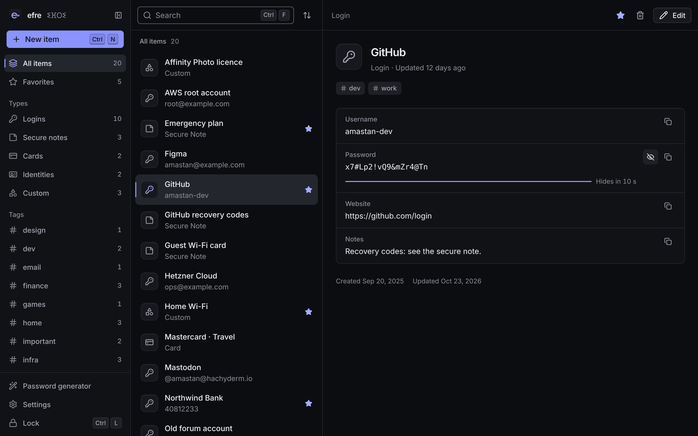
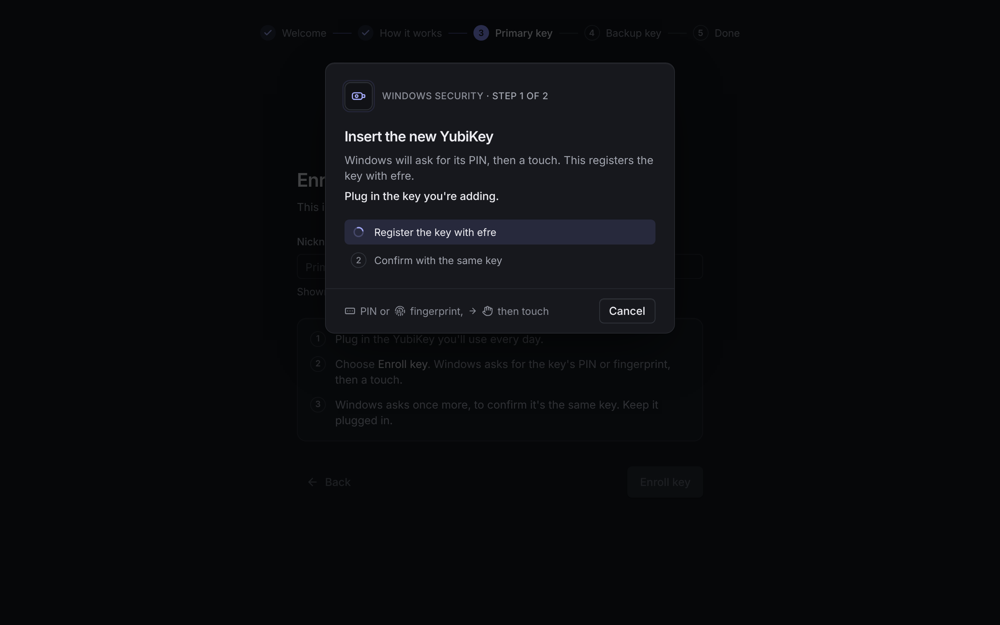
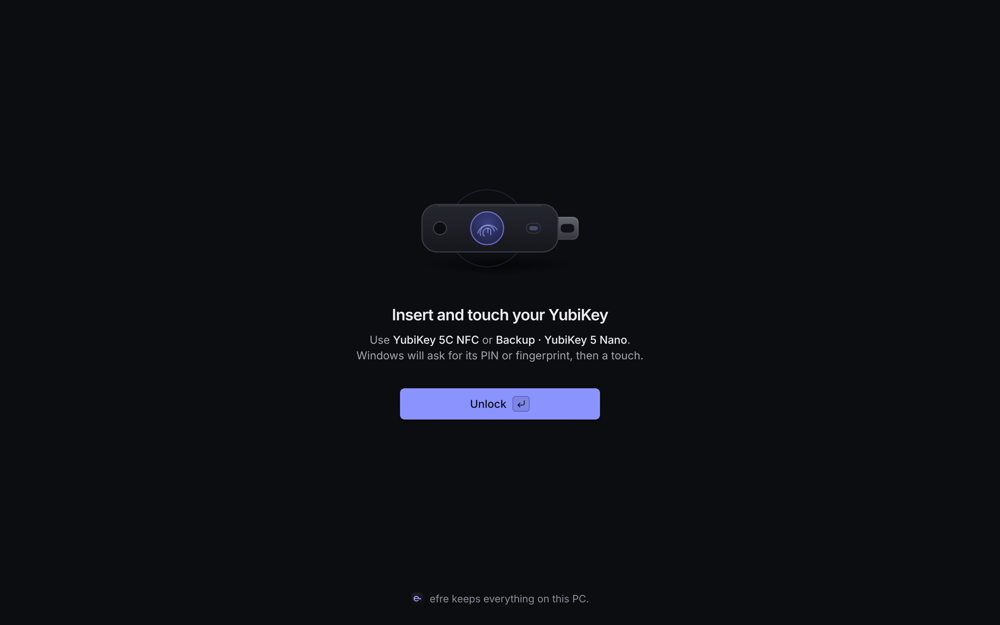
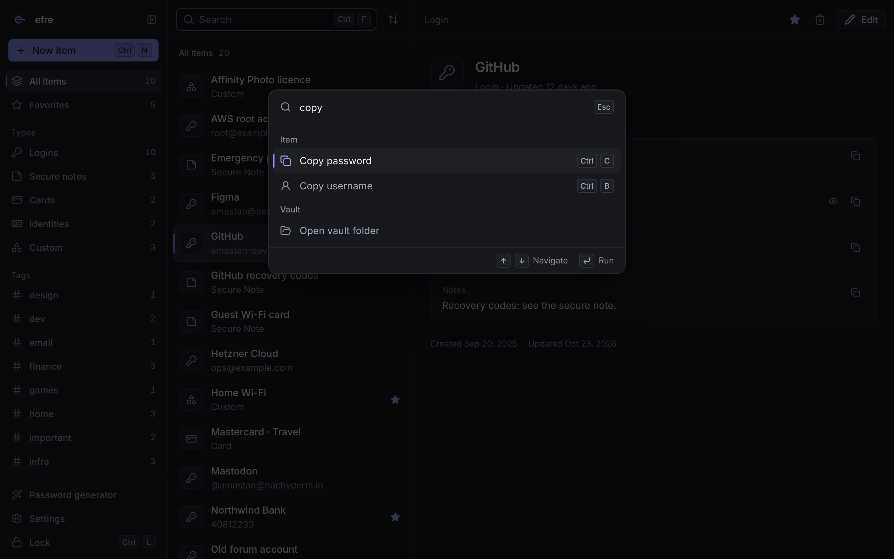
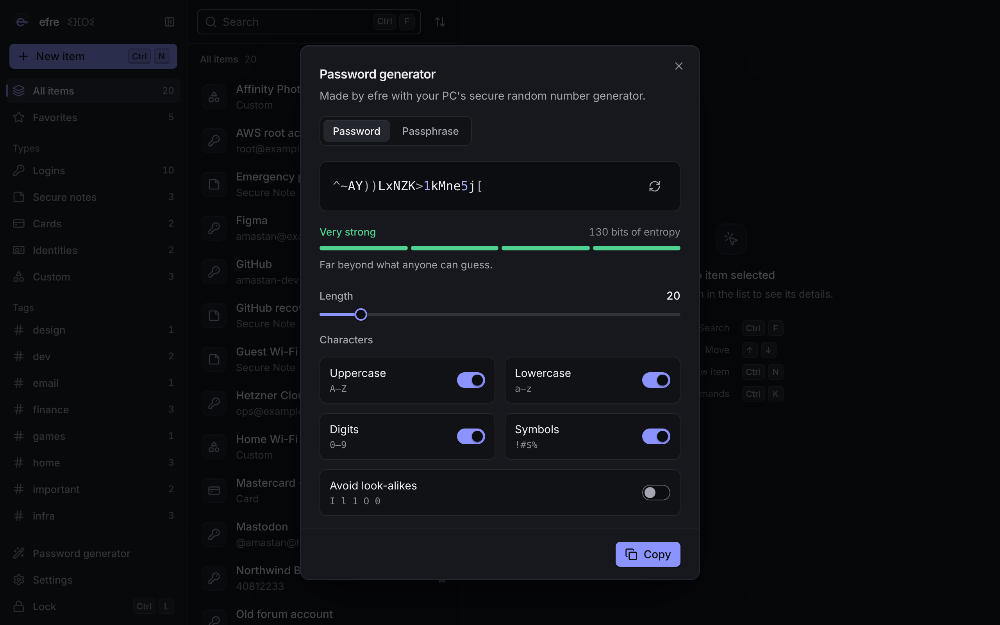
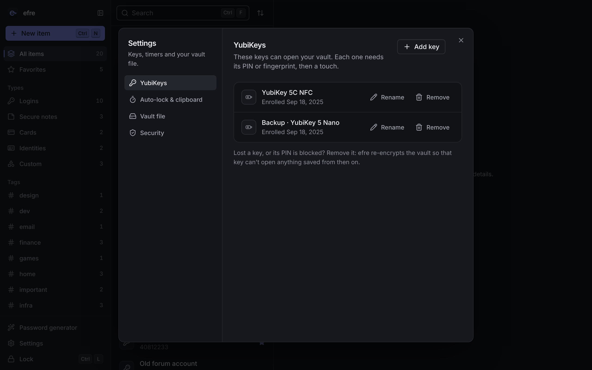
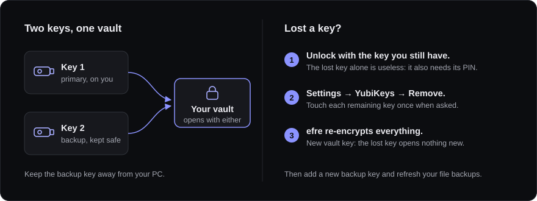
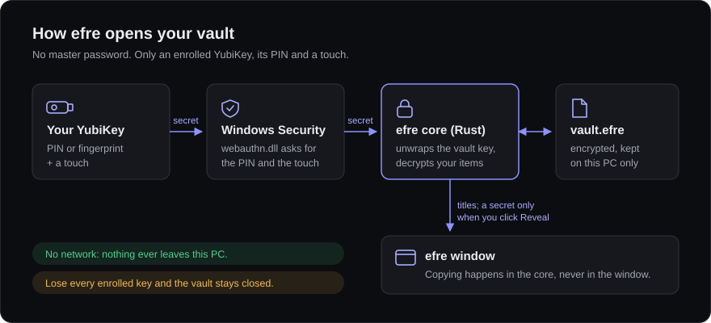

<p align="center">
  
</p>

<h1 align="center">efre</h1>

<p align="center">
  <em>efre</em> is Tamazight for <em>cave</em>.<br>
  An offline password vault for Windows that opens only with your YubiKey.
</p>

<p align="center">
  <a href="https://github.com/Ak1ra00/efre/actions/workflows/ci.yml"></a>
  <a href="LICENSE"></a>
</p>



## Why efre

- **No master password.** The vault opens with an enrolled YubiKey, its PIN (or
  fingerprint on a YubiKey Bio) and a touch. There is nothing to guess or phish.
- **Fully offline.** No account, no cloud, no sync, no telemetry and no updater. efre
  contains no network code at all, and CI enforces that.
- **Secrets stay in the core.** Keys and decrypted secrets live only in efre's Rust
  core and are wiped on lock. Copying happens there too, so the app window never sees
  what you copy.
- **Built for two keys.** Enroll a primary and a backup key. If you lose one, remove
  it: efre re-encrypts everything so the lost key opens nothing new.
- **Fast and keyboard-first.** Fuzzy search, a Ctrl+K command palette, a password and
  passphrase generator, and a dark, minimal interface.

Read **[SECURITY.md](SECURITY.md)** for what efre protects against and its honest
limits.

## What you need

| | |
|---|---|
| **Windows** | Windows 11, or Windows 10 version 1903 or later, with the latest updates. |
| **WebView2** | Built into Windows 11. On Windows 10 it comes with Microsoft Edge. |
| **YubiKeys** | Two YubiKeys with FIDO2: YubiKey 5 series, Security Key series, or YubiKey Bio. One works, but you'll be reminded to add a backup. |
| **A FIDO2 PIN** | Set on each key. See [step 1](#1-set-a-pin-on-each-yubikey) below. |

efre never asks for administrator rights.

## Install

> **Note:** efre doesn't have a signed release yet. Until code signing is in place,
> the installer comes from the project's CI builds.

1. Open the [**Actions** page](https://github.com/Ak1ra00/efre/actions/workflows/ci.yml),
   signed in to GitHub.
2. Open the newest run on branch `main` that has a green tick.
3. Under **Artifacts**, download **`efre-windows-unsigned-…`** and unzip it.
4. Run **`bundle\nsis\efre_0.1.0_x64-setup.exe`**.
   - SmartScreen warns about unsigned apps. Choose **More info → Run anyway**.
   - The installer puts efre in your user profile, so there is no admin prompt.
5. Start **efre** from the Start menu.

Prefer to build it yourself? See [Build from source](#build-from-source).

## How to use efre

### 1. Set a PIN on each YubiKey
Skip this step if your keys already have a FIDO2 PIN.

1. Open Windows **Settings → Accounts → Sign-in options → Security key → Manage**.
2. Insert the key, touch it, and choose **Security key PIN → Add** (or **Change**).
3. Pick a PIN of 6 or more characters. Don't reuse your Windows PIN.

Do this for **both** keys.

> **Careful:** after 8 wrong PINs a YubiKey blocks its PIN. Unblocking it means a
> FIDO reset, which erases every passkey on that key.

### 2. First run: enroll your keys
The first time you open efre, a short wizard walks you through setup. Its steps are:
welcome → how efre works → enroll the **primary** key → enroll the **backup** key →
done.



For each key, efre tells you which key to insert. Windows Security then asks
**twice**: once to create efre's credential on the key, and once to confirm it. Each
time, enter the PIN and touch the key.

You can finish with one key, but efre shows a reminder until you add a backup in
Settings.

### 3. Unlock
Insert any enrolled key and choose **Unlock**. When Windows Security asks, enter the
PIN and touch the key.



If something goes wrong (no key, wrong PIN, a key that isn't enrolled), the unlock
screen explains what happened and how to fix it. See
[Troubleshooting](#troubleshooting).

### 4. Add and find items
- **New item:** press **Ctrl+N**, or use **New** in the sidebar. Pick a kind: Login,
  Secure Note (Markdown), Card, Identity, or Custom.
  - Custom fields can be text, hidden, URL, email, phone, date or multiline.
- **Organise:** add tags, star favorites, change the sort order, and filter by kind,
  tag or favorites in the sidebar.
- **Find:** press **Ctrl+F** and type. Search is fuzzy, so `gthb` finds *GitHub*.
- **Delete:** deleted items go to **Trash**. Undo right away from the toast, restore
  them later, or empty the trash.

### 5. Copy and reveal
- **Copy:** use the copy button next to a field. **Ctrl+C** copies the password and
  **Ctrl+B** copies the username of the selected item.
  - The value is copied from efre's core, never through the window. It stays out of
    clipboard history (Win+V) and is cleared after 30 seconds, but only if it's still
    on the clipboard.
- **Reveal:** hidden fields show as dots. **Reveal** shows the value for 10 seconds,
  then hides it again.

### 6. Command palette
Press **Ctrl+K** to run any action by typing: open an item, copy a password, create
an item, open the generator, lock, open settings, and so on.



### 7. Generate passwords and passphrases
Open the generator from the palette, or from a password field in the editor.
- **Passwords** of 8–128 characters, from the character groups you choose.
- **Passphrases** of 3–12 words from the EFF long wordlist.
- The strength meter shows the estimated entropy.
- **Use** puts the result in the field you're editing. **Copy** copies it, again
  from efre's core.



### 8. Lock and auto-lock
Press **Ctrl+L** to lock. efre also locks by itself:
- after a few idle minutes (5 by default);
- when the PC sleeps or hibernates;
- when you lock Windows (Win+L), switch user or sign out;
- when you unplug your last YubiKey.

Locking wipes everything decrypted from memory and resets the window. The unlock
screen tells you why it locked.

### 9. Settings
Press **Ctrl+,** or use the palette. Settings has four sections:
- **YubiKeys:** see each key's nickname and enrolled date, and add, rename or remove
  keys. Every change needs your PIN and a touch.
- **Timers:** the auto-lock delay (1–120 minutes) and the clipboard clear delay
  (5–300 seconds).
- **Vault:** **Open vault folder**, so you can back up the encrypted file.
- **Security:** the protections active on this PC, and the honest limits.



### 10. Lost a key?


1. Unlock with the key you still have.
2. Go to **Settings → YubiKeys**, choose **Remove** on the lost key, and confirm.
   Windows Security asks you to touch each remaining key once.
3. efre generates a new vault key and re-encrypts every item, so the lost key can't
   open anything from now on.
4. Enroll a new backup key, and replace old copies of your vault file. An old copy
   can still be opened with the lost key and its PIN.

efre won't let you remove your last key.

### 11. Back up your vault
Your vault is a single encrypted file: **`%LOCALAPPDATA%\efre\vault.efre`**.

1. In efre, open **Settings → Vault → Open vault folder** (or lock efre first).
2. Copy **`vault.efre`** to a USB drive or another disk.
3. To restore, quit efre and put the file back in that folder.

A backup is only useful with an enrolled key, so keep at least one key safe. A backup
opens only with the keys that were enrolled when you made it.

## How it works



- At enrollment, each YubiKey creates a credential for efre. Unlocking asks the key
  for its FIDO2 `hmac-secret`, which requires your PIN and a touch.
- That secret derives a key-encryption key (HKDF-SHA256). The key-encryption key
  unwraps the random 256-bit vault key.
- Items are encrypted with XChaCha20-Poly1305. The header and the item list are
  authenticated with HMAC-SHA256. If anything was changed outside efre, efre refuses
  to open the vault.
- The vault is one SQLite file, and only ids, nonces and ciphertext are stored. Item
  titles, URLs and tags are encrypted too.

The full design is in [docs/ARCHITECTURE.md](docs/ARCHITECTURE.md); §5 is the
cryptographic specification.

## Keyboard shortcuts

| Keys | Action |
|---|---|
| Ctrl+K | Command palette |
| Ctrl+N | New item |
| Ctrl+F | Search |
| Ctrl+C | Copy password of the selected item |
| Ctrl+B | Copy username of the selected item |
| Ctrl+L | Lock |
| Esc | Back / close |
| ? | Shortcut sheet |

## Troubleshooting

| You see | What to do |
|---|---|
| **No YubiKey found** | Plug the key in (try another USB port), then try again. |
| **Cancelled** | The Windows Security prompt was closed. If Windows said it didn't recognise the key, that key isn't enrolled in this vault: use your other key. |
| **Wrong PIN** | Try again carefully. After too many wrong tries the key blocks its PIN. |
| **PIN blocked** | Unlock with your backup key, then remove the blocked key in Settings. A FIDO reset (in Yubico Authenticator) makes the key usable again, but erases all its passkeys. Enroll it again afterwards. |
| **Set a PIN first** | The key has no FIDO2 PIN. See [step 1](#1-set-a-pin-on-each-yubikey). |
| **Update Windows** | Your Windows can't provide the key secret efre needs. Install all Windows updates. |
| **Not a genuine YubiKey** | efre only enrolls YubiKeys whose attestation verifies. |
| **The vault failed its integrity check** / **The vault file is damaged** | `vault.efre` was changed or damaged outside efre. Quit efre and restore a backup you trust. |
| **The vault is in use** | Another program has `vault.efre` open (a backup tool, or a second copy of the file in use). Close it and try again. |
| **"efre is not supported on this PC"** | The screen names the reason. It's usually an old Windows version or missing WebView2. |

## Build from source

You need Windows 10/11, plus:
- [Rust](https://rustup.rs) (the repo pins the version in `rust-toolchain.toml`);
- [Node.js](https://nodejs.org) 22.12 or later;
- Visual Studio Build Tools with the **Desktop development with C++** workload.

To install them with winget (Build Tools asks for admin approval once):
```powershell
winget install --id Rustlang.Rustup -e
winget install --id OpenJS.NodeJS.LTS -e
winget install --id Microsoft.VisualStudio.2022.BuildTools -e --override "--wait --passive --add Microsoft.VisualStudio.Workload.VCTools --includeRecommended"
```

Then open a **new** PowerShell window:
```powershell
git clone https://github.com/Ak1ra00/efre
cd efre
rustup toolchain install
npm.cmd ci
npm.cmd run tauri build      # installer: target\release\bundle\nsis\
```

### Development commands
```sh
npm run dev               # run the app with hot reload (Windows)
npm run dev:mock          # UI only, in a browser, with a simulated backend and keys
npm run typecheck && npm run lint && npm test
cargo fmt --all
cargo clippy --workspace --all-targets -- -D warnings
cargo test --workspace
cargo deny check && cargo audit
```
Run `npm run build` once before the `cargo` commands, because the app embeds `dist/`.
The simulated YubiKey exists only in tests and the mock preview. CI proves that a
release build can't include it.

### Repository layout
| Path | What's there |
|---|---|
| `crates/efre-core` | Vault format, crypto, storage, generator. Platform-independent. |
| `crates/efre-authn` | YubiKey access through the Windows WebAuthn API, attestation, and the unplug watcher. |
| `src-tauri` | The app: IPC commands, auto-lock, clipboard, window hardening. |
| `src` | The React interface. |
| `docs` | [Architecture](docs/ARCHITECTURE.md), [IPC contract](docs/IPC.md), [frontend guide](docs/FRONTEND.md), and the hardware and app test checklists. |

## License

efre is released under the [MIT License](LICENSE). Bundled third-party material,
including the EFF wordlist, the Inter font and the Lucide icons, is listed in
[THIRD_PARTY_NOTICES.md](THIRD_PARTY_NOTICES.md).

YubiKey is a trademark of Yubico AB. efre is an independent project, not affiliated
with Yubico.
